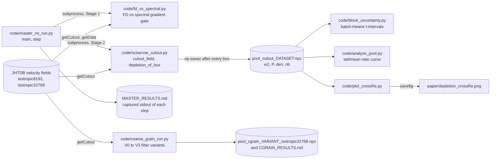
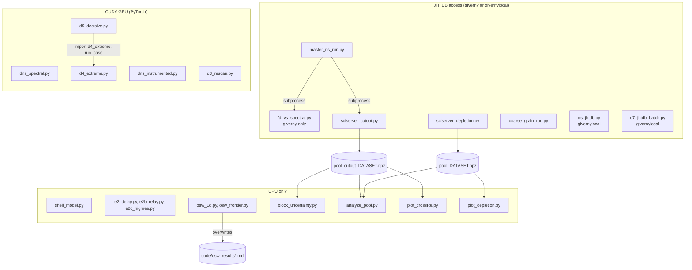
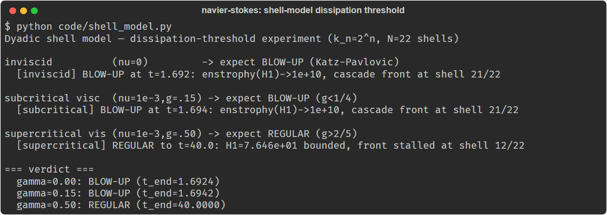

# Geometric depletion of enstrophy production in the extreme vorticity tail

**A Reynolds-number study toward the Navier-Stokes regularity question.** Reproducibility package
(DNS solver, JHTDB pipeline, 1D and shell models, analysis and figure code) for readers who want to
check or extend the paper's measurements.

Reproducibility package for the paper:

> Cristian Ruvalcaba and the Agentic AI Research Team · Saluca Labs.
> *Geometric depletion of enstrophy production in the extreme vorticity tail:
> a Reynolds-number study toward the Navier-Stokes regularity question.* (v0.6, 2026)
> Zenodo concept DOI: [10.5281/zenodo.20970675](https://doi.org/10.5281/zenodo.20970675)
> (resolves to the latest version)

The paper itself (Markdown + PDF, v0.6 dated 2026-07-01) is in [`paper/`](paper/).

---

## Status

Research artifact. The code on `master` matches paper v0.6 (commit of 2026-07-01). The scripts are
the instruments that produced the paper's numbers, not a packaged library; most need either a CUDA
GPU (the DNS) or JHTDB access (the production pipeline).

> **Correction, 2026-10-22:** until today this README stated the v0.5 main result, including
> "A **mild de-depletion with Reynolds number** is statistically resolved at top-1%" and
> "block-resampled 95% intervals". Paper v0.6 (2026-07-01, in this repository since that date)
> **withdrew** the first claim: the intervals used a normal rather than a Student t multiplier, and
> a paired coarse-graining experiment (`coarse_grain_run.py`, §6.1) found the resolution bias runs
> *with* the observed trend, absorbing about 60% of the top-1% difference. After that correction
> the cross-Reynolds difference is **not statistically resolved** at top-1% (suggestive at
> top-0.1%). The intervals are contiguous-block batch-means t-intervals, not a resample. The
> README also cited the v0.5 version DOI (10.5281/zenodo.21084339); it now cites the concept DOI.
> The main result below is the v0.6 statement.

## What this is

The global regularity of the 3D incompressible Navier-Stokes equations turns on whether
vortex stretching can drive the enstrophy to infinity in finite time. A classical
obstruction is **geometric depletion** (Constantin-Fefferman): the nonlinear enstrophy
production `ω·Sω` is suppressed below its dimensional bound `|ω|²|S|` because vorticity
preferentially aligns with the *intermediate* eigenvector of the strain tensor.

This work measures the depletion ratio

```
D = ⟨ω·Sω⟩ / ⟨|ω|² |S|⟩
```

**as a function of vorticity percentile** - i.e. in the most intense events, the ones that
would actually seed a singularity - and asks **how it scales with Reynolds number**.

**Main result (v0.6).** Extreme-tail depletion is *resolved below unity* (regularizing) at
the top-1% and top-0.1% at both `R_λ ≈ 1300` (`isotropic8192`, 77M points) and `R_λ = 2500`
(`isotropic32768` exascale, 164M points); contiguous-block (batch-means) 95% t-intervals exclude 1.
The tail depletion is directionally weaker at the higher Reynolds number (the Buaria-Pumir
direction), but once the measured resolution bias is applied that difference is **not
statistically resolved** at top-1% (suggestive at top-0.1%). Reported as a two-point comparison,
**not** a scaling law; the deepest tail (top-0.01%) is resolution-limited.

**Where each number comes from.** The tail ratios are re-derived by
[`code/sciserver_cutout.py`](code/sciserver_cutout.py) (pools of `w2`, `P`, `den` per grid point from
JHTDB), the 95% t-intervals by [`code/block_uncertainty.py`](code/block_uncertainty.py), the
resolution-bias correction by [`code/coarse_grain_run.py`](code/coarse_grain_run.py) (paper §6.1),
and Fig. 2 by [`code/plot_crossRe.py`](code/plot_crossRe.py). The per-point pools (`.npz`) are not in
this repository; they are regenerated from the public JHTDB fields (see [Data](#data)). The archived
record is the concept DOI [10.5281/zenodo.20970675](https://doi.org/10.5281/zenodo.20970675).

## How it works

The production data path, traced from the scripts on `master` (every box is a file, every arrow a
call, subprocess or file the script reads or writes):



`block_uncertainty.py` and `analyze_pool.py` print to stdout; `fd_vs_spectral.py` prints only, and
`master_ns_run.py` captures that output into `MASTER_RESULTS.md`. `master_ns_run.py` runs the two
stages one after the other; no file passes from the gate to the cutout run.

## Install

Tested 2026-10-22 for the CPU-only models on Python 3.12.10 with numpy 2.4.6, scipy 1.17.1 and
matplotlib 3.10.9. There is no package; clone and install what the script you want needs:

```bash
git clone https://github.com/saluca-labs/navier-stokes
cd navier-stokes
# for the shell model, the 1D OSW model, the analysis and the figures:
python -m pip install numpy scipy matplotlib
```

- **DNS** (`dns_spectral.py`, `dns_instrumented.py`, `d3_rescan.py`, `d4_extreme.py`,
  `d5_decisive.py`): PyTorch with CUDA. The scripts select `cuda` (preferring a device whose name
  contains "5090") and have no CPU fallback. Not run in the 2026-10-22 check (no CUDA PyTorch in
  the test environment).
- **JHTDB pipeline** (`sciserver_*.py`, `fd_vs_spectral.py`, `coarse_grain_run.py`,
  `master_ns_run.py`): the `giverny` package inside a SciServer container, or `givernylocal`
  elsewhere (`ns_jhtdb.py`, `d7_jhtdb_batch.py`). Not run in the 2026-10-22 check.

## Quickstart

The shell-model dissipation-threshold experiment runs on a CPU in about 6 seconds:

```bash
python code/shell_model.py
```

Last lines of the output from a run on 2026-10-22 (full capture in
[`docs/img/shell-model-threshold-2026-10-22.out`](docs/img/shell-model-threshold-2026-10-22.out)):

```
=== verdict ===
  gamma=0.00: BLOW-UP (t_end=1.6924)
  gamma=0.15: BLOW-UP (t_end=1.6942)
  gamma=0.50: REGULAR (t_end=40.0000)
```

This matches experiment E1 in [`code/RESULTS.md`](code/RESULTS.md) (blow-up at t ≈ 1.69; the
supercritical case stalls at shell 12 with enstrophy about 76).

## Usage

| command | what it does | checked 2026-10-22 |
|---|---|---|
| `python code/shell_model.py` | dyadic shell model, three viscosity regimes | ran, output above |
| `python code/osw_1d.py --N 2048 --avals 0,1.0` | 1D OSW model: CLM (a=0) vs De Gregorio (a=1) | ran in about 37 s: a=0 BLOW-UP at t=2.015, a=1 regular |
| `python code/osw_frontier.py` | low-Hölder data for De Gregorio, N-convergence | not run |
| `python code/dns_spectral.py [N] [nu] [T]` | GPU pseudospectral DNS, Taylor-Green vortex | not run (needs CUDA) |
| `python code/sciserver_cutout.py` | production JHTDB cutout pipeline | not run (needs SciServer / JHTDB) |
| `python code/block_uncertainty.py <pool.npz> <label> [K]` | batch-means t-intervals on a pool | not run (pools are not in the repo) |
| `python code/analyze_pool.py <pool.npz> [label]` | tail/mean ratio curve on a pool | not run (pools are not in the repo) |
| `NS_POOL_DIR=<dir> python code/plot_crossRe.py` | redraws `paper/depletion_crossRe.png` from the two pools | not run (pools are not in the repo) |

`osw_1d.py` and `osw_frontier.py` overwrite the tracked `code/osw_results*.md` files next to them;
copy the scripts elsewhere if you want to keep the archived results.

## Repository layout

```
paper/    the paper (.md + .pdf) and the cross-Reynolds figure
code/     DNS solver, JHTDB pipeline, 1D model, analysis, bootstrap, figure code
```

## Architecture

### Key scripts (`code/`)

| File | Role |
|------|------|
| `dns_spectral.py`, `dns_instrumented.py` | In-house pseudospectral DNS (validation + canonical alignment) |
| `fd_vs_spectral.py` | Finite-difference vs. spectral gradient sanity check |
| `sciserver_cutout.py`, `sciserver_depletion.py` | Production JHTDB pipeline (SciServer cutouts → depletion statistic) |
| `coarse_grain_run.py` | v0.6 paired coarse-graining experiment: measures the resolution bias directly (§6.1) |
| `ns_jhtdb.py`, `d7_jhtdb_batch.py` | Early JHTDB pipeline / batched testing-token accumulation |
| `master_ns_run.py` | Orchestrator for the cross-Reynolds production runs |
| `osw_1d.py`, `osw_frontier.py` | 1D OSW model solver (finite-time blow-up scan of the depletion mechanism) |
| `shell_model.py` | Shell-model corroboration |
| `analyze_pool.py`, `block_uncertainty.py` | Analysis and contiguous-block batch-means uncertainty (not point bootstrap) |
| `plot_crossRe.py`, `plot_depletion.py` | Figure code |
| `d3_rescan.py`, `d4_extreme.py`, `d5_decisive.py`, `e2*.py` | Exploratory percentile / extreme-tail scans (research trail) |
| `*_results.md`, `RESULTS.md` | Run provenance |

The production path is drawn under [How it works](#how-it-works). The diagram below groups every
script by what it needs to run, traced from its imports and the files it reads and writes:



The pools move from the JHTDB side to the CPU side as downloaded files; nothing in the repository
transfers them. The CPU scripts need only numpy, scipy and matplotlib. `d7_jhtdb_batch.py` writes
the git-ignored `code/_d7_pool.npz`, and `d5_decisive.py` writes `experiments/d5_result.txt`, a directory that is not in the
repository.

### In this repository and not in it

| Layer | In this repo | Where it lives |
|---|---|---|
| Paper v0.6 (Markdown, PDF, Fig. 2) | yes | [`paper/`](paper/); archived at the concept DOI |
| Solvers, pipeline, analysis and figure code | yes | [`code/`](code/), MIT |
| Run logs of the CPU and exploratory experiments | yes | [`code/RESULTS.md`](code/RESULTS.md), `code/osw_*results*.md` |
| Turbulence fields | no | Johns Hopkins Turbulence Database, read through `giverny` |
| Per-point pools (`.npz`), `MASTER_RESULTS.md`, `CGRAIN_RESULTS.md` | no | written by the scripts at run time; `*.npz` and `*.log` are git-ignored |
| Fig. 1 source image (`experiments/depletion_ratio_vs_Re.png`) | no | referenced by the paper Markdown, not committed |

A map of every document, grouped by what it answers, is in [`docs/README.md`](docs/README.md).

## Data

The turbulence fields are the public **Johns Hopkins Turbulence Database** (JHTDB), datasets
`isotropic8192` and `isotropic32768`, accessed via `giverny` / SciServer. The geometric-depletion
statistic and the per-snapshot audit are reproducible directly from them - no private data is required.

- The scripts default to the **public** JHTDB testing token `edu.jhu.pha.turbulence.testing-201406`,
  which is rate-limited to small queries (fine for the DNS validation and small cutouts).
  `master_ns_run.py` is the exception: it has no default and exits unless `JHTDB_TOKEN` is set.
- The high-statistics production runs need a **free registered JHTDB token**. Set it via
  `export JHTDB_TOKEN=...` (a placeholder `YOUR_REGISTERED_JHTDB_TOKEN` appears in the docs/help text).
- Register at <https://turbulence.pha.jhu.edu/>.

### Reproduction notes / gotchas

- Production cutouts run on SciServer; `getCutout` with `B=128` hangs on the `isotropic32768`
  cube - use `B=64`.
- The per-box pool is checkpointed as an `.npz` that is rewritten whole each box: **never analyze a
  pool `.npz` while a run is in progress** (it will be a torn/corrupt read). Read the result from the
  `MASTER_RESULTS.md` / `CUTOUT FINAL` log line instead.
- `plot_crossRe.py` opens `pool_cutout_isotropic8192(2).npz` and `pool_cutout_isotropic32768(2).npz`
  (with the `(2)` suffix) in `NS_POOL_DIR`, while `sciserver_cutout.py` writes
  `pool_cutout_<dataset>.npz`. Rename the pools, or the script fails on open.
- **Known discrepancy, found 2026-10-22:** `plot_crossRe.py` still draws the Fig. 2 bands with the
  normal multiplier (`1.96 * sem`) and its docstring calls them "block-resampled". Paper v0.6 states
  that the tabulated intervals use `t_19 = 2.093` (about 7% wider); `block_uncertainty.py` uses the t
  multiplier. The bands in `paper/depletion_crossRe.png` are therefore about 7% narrower than the
  corrected intervals in the paper's table. The code and figure are unchanged here; the fix is
  pending.

## Screenshots



Captured 2026-10-22 from a clean clone; command and captured text in
[`docs/img/shell-model-threshold-2026-10-22.out`](docs/img/shell-model-threshold-2026-10-22.out).

## Provenance & method

This is a human-validated, AI-accelerated research artifact. An agentic large-language-model system
(operated by Saluca Labs) performed literature mapping, code authoring, and closed-loop analysis;
every quantitative claim rests on the human-validated, reproducible artifacts in this repository. No
result is treated as established solely because an AI produced it. See the paper's *Provenance* and
*Data and code availability* sections for the full disclosure.

## Citation

Cite the paper by its Zenodo concept DOI,
[10.5281/zenodo.20970675](https://doi.org/10.5281/zenodo.20970675), which resolves to the latest
version. [`CITATION.cff`](CITATION.cff) carries the same DOI.

## License

Split by path, declared file by file in [`REUSE.toml`](REUSE.toml) ([REUSE](https://reuse.software)
layout; the licence texts are in [`LICENSES/`](LICENSES/)):

- **Code and repository docs** (`code/*.py`, README, AGENTS.md, llms.txt, `docs/`): **MIT**, see
  [`LICENSE`](LICENSE). Copyright 2026 Cristian Ruvalcaba / Saluca Labs.
- **Paper and results** (`paper/`, and the result logs `code/RESULTS.md`, `code/osw_results*.md`,
  `code/osw_frontier_results.md`): **CC-BY-4.0**, the licence of the Zenodo record.

## Links

- Paper (this repo): [`paper/geometric_depletion_paper.md`](paper/geometric_depletion_paper.md),
  [`paper/geometric_depletion_paper.pdf`](paper/geometric_depletion_paper.pdf)
- Zenodo record: https://doi.org/10.5281/zenodo.20970675
- Run log of the exploratory experiments: [`code/RESULTS.md`](code/RESULTS.md)
- Johns Hopkins Turbulence Database: https://turbulence.pha.jhu.edu/

_Last updated: 2026-10-22_
